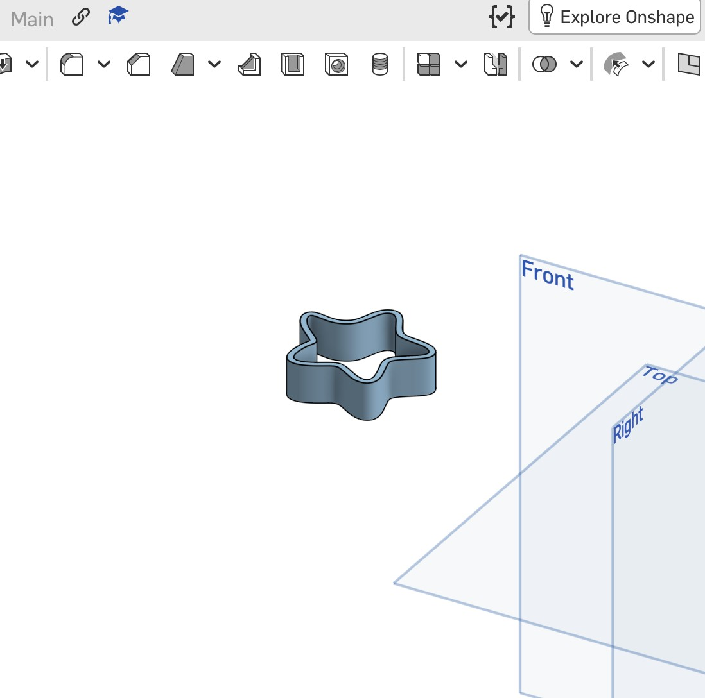
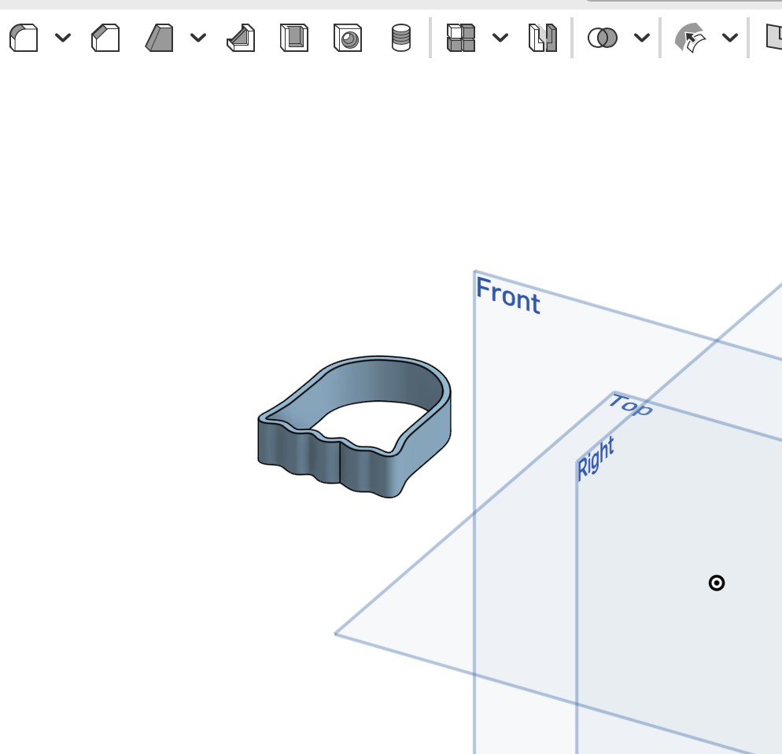

# Bake-Build-Workshop
# Bake Build — Cookie Cutter Designs

A CAD project made as part of **Hack Club's Bake Build workshop**.

## Overview
Designed three custom cookie cutters using Onshape. One design was submitted for the workshop, while the other two were additional designs I created during the process.

## Designs
- Cookie Cutter 01 — Submitted design
- Cookie Cutter 02 — Additional design
- Cookie Cutter 03 — Additional design

## Tools
- Onshape
- CAD / 3D modelling

## Files
The repository contains STEP files for all three cookie cutter designs.

## Skills Practised
- 2D sketching
- CAD modelling
- Geometric design
- 3D modelling
- Exporting STEP files

- ## Design Gallery

### Cookie Cutter 1.0

### Cookie Cutter 2.0

### Cookie Cutter 3.0

